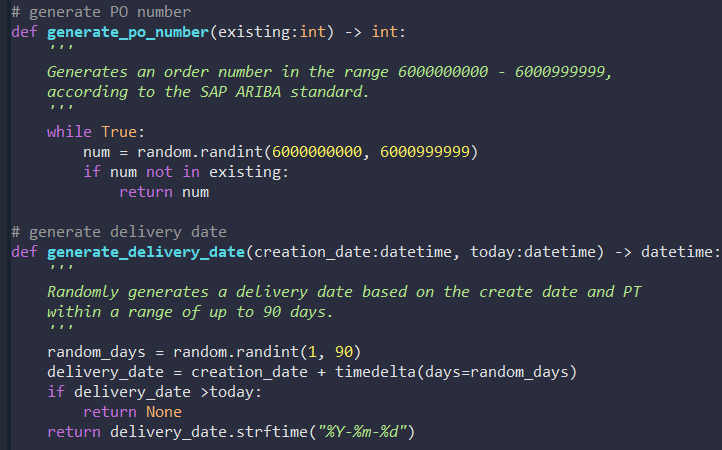
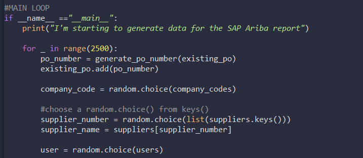
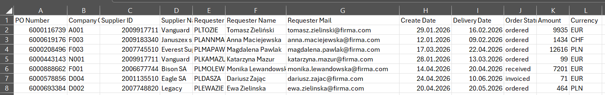
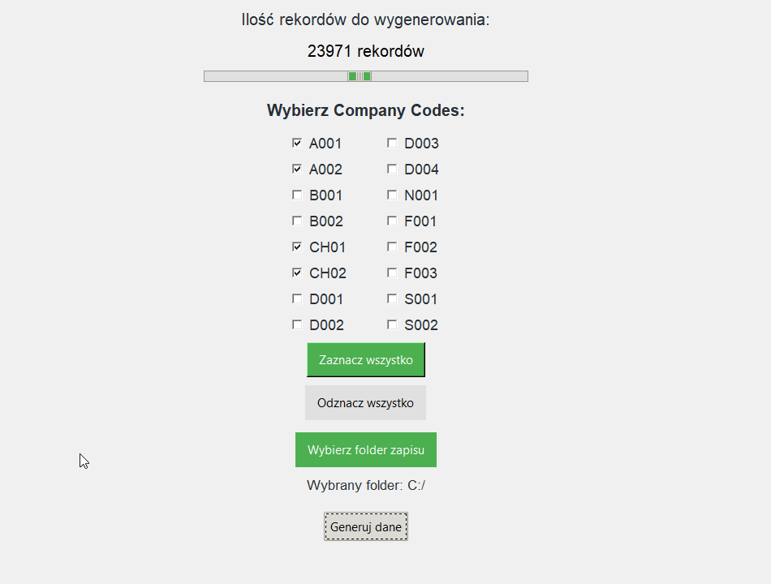

# SAP-Ariba-Mock-Data-Generator-for-Procurement-Analytics

A Python-based tool designed to generate synthetic, production-grade Purchase Order (PO) datasets, including the SAP Ariba Reporting standards.📊


⬇️ Download the installer (Windows, no Python needed): [SAP_Mock_Generator.msi – v1.1.0](https://github.com/kamila-dudzinska/SAP-Ariba-Mock-Data-Generator-for-Procurement-Analytics/releases/tag/v1.1.0)


🚀A Python-based tool designed to generate synthetic, production-grade Purchase Order (PO) datasets, including the SAP Ariba Reporting standards. It accurately mirrors the technical architecture, data engineering principles, and business logic of the SAP Ariba ecosystem.

💡 The Problem It Solves? 

Procurement professionals transitioning into data analytics face a major roadblock: the inability to work with real corporate data due to strict compliance rules, non-disclosure agreements (NDAs), and GDPR regulations.


🛠️ The Solution - This script allows domain experts and data analysts to instantly spin up a 100% compliant, secure, and realistic test environment. It provides the perfect dataset to practice data cleaning, exploratory data analysis (EDA), and data visualization.


IDE: Spyder (Python 3.13)


🧩 Modules: Pandas, Random, Datetime, CSV, openpyxl, tkinter, pytest


Project's Structure:

The project is organized in a modular way to separate input data, source code, documentation, and generated outputs.  
Each folder serves a clear purpose:

| Folder / File | Description |
|----------------|-------------|
| **data/** | Contains input files used by the generator, e.g. regex patterns (`mock_regex.xlsx`, `regex1.xlsx`) for creating realistic SAP Ariba mock data. |
| **data_output/** | Stores generated datasets — `procurement_mock_2500.xlsx` is a sample output file with 2 sheets: Ariba (POs) + Invoices. (extended 31.10.2026) |
| **src/** | Source code of the project: <br>• `__init__.py` – module initializer <br>• `procurement_dataset1.py` – main SAP Ariba data generator script <br>• `procurement_mock_functions.py` – helper functions with professional docstrings forming the generator’s API <br>• `gui_one.py` – graphical interface (tkinter), the base of the .exe and .msi. (extended 01.11.2026) |
| **docs/** | Technical documentation and data description in Jupyter Notebook format (`data_description.ipynb`). |
| **images/** | Screenshots and visual examples (`mock1.png`, `mock2.png`, `mock3.png`, `po_status.png`) used in README to illustrate generator results. |
| **tests/** | Folder for unit tests and data validation scripts. |
| **README.md** | Project documentation describing purpose, workflow, and sample outputs. |
| **Dockerfile** | Runtime environment definition for containerization. |
| **requirements.txt** | List of required Python libraries. |
| **pytest.ini** | Configuration for automated testing. |
| **LICENSE** | Project license information (MIT). |
| **.gitignore** | Excludes unnecessary files from Git tracking. |


📁 How to run?

Option 1 – installer (no Python needed):
1. Download SAP_Mock_Generator.msi from Releases (v1.1.0).
2. Install it, choose any folder - shortcuts are added to the Start menu and desktop.
3. Run the program, choose the settings and click "Generuj dane". (extended 01.11.2026)

Option 2 – Python:
1. Copy the repository.
2. Install the modules: pip install -r requirements.txt
3. Run src/gui_one.py (GUI) or src/procurement_dataset1.py (script, CSV output).

   
🧪 How to run tests?

Project test run on module **pytest**.

To run tests:
```bash
python -m pytest -v
```

✨ Key Features

- Consistent supplier data — Supplier IDs always have 10 digits (200 + 7 digits), the same as in my Mobi and Invio projects, so every record passes the regex validation. (extended 31.10.2026)

- Test data uses @example.com email addresses (a domain reserved for testing), so no real person can receive an email. (extended 31.10.2026)

- Excel output with 2 sheets — Ariba (purchase orders) and Invoices (the same POs with invoice data). (extended 31.10.2026)

- Dynamic date range — the user chooses "Data od" / "Data do" in the GUI (up to 5 years back), perfect for year-over-year analysis and later ETL. Default: the last 12 months. (extended 31.10.2026)

- Realistic invoices — invoice date is never in the future; POs with delivery in the future have no invoice yet (empty fields, status 'ordered'). Invoice number takes the year and month from the invoice date: FV/2025/03/00914. (extended 01.11.2026)

- Realistic procurement dataset generation — creates synthetic Purchase Orders, suppliers, users, companies and delivery windows that mimic SAP Ariba patterns.

- Business‑driven logic — all values follow procurement rules: lead times, approval flows, delivery dates, spend categories, and supplier behavior.

- Regex‑based validation — every generated field is validated using strict regex rules to ensure consistency and realism.

- GDPR‑safe synthetic data — no personal or confidential information; all records are fully anonymized and safe for analytics training.

- Configurable output structure — users can adjust the number of records, date ranges, supplier pools, spend categories, and business rules.

- SAP Ariba‑aligned fields — column names and logic follow typical Ariba procurement objects (PO, Supplier, User, Company, Amount, Dates).

- Extensible architecture — easy to add new fields, business rules, validation layers, or additional procurement modules (invoices, contracts, sourcing events).


How to adjust the amount of mock data? 🧪
--> GUI: type the number of records (100 – 50 000) or use the slider - both work together. (extended 01.11.2026)
--> Script: in procurement_dataset1.py change the number in brackets --> for _ in range(2500)


🔄 Version history: v1.0 → v1.1 (extended 01.11.2026)

After a few months I came back to this project with fresh eyes. v1.0 focused on functionality, v1.1 on usability and design.

| | v1.0 | v1.1 |
|---|---|---|
| Number of records | slider only | type the number or use the slider |
| Company Codes | one long list | 4 compact columns |
| Look | default tkinter | dark green theme, consistent with Mobi (navy) and Invio (plum) |
| Output | CSV, 12 columns | Excel: Ariba + Invoices |
| Dates | fixed January – May 2026 | chosen by the user, up to 5 years back |

--> with the slider only it was really hard to hit round values like 2 500 or 10 000 - now you just type it.
--> Company Codes in one column made the window long, you had to follow a big area with your eyes - 4 columns are compact and easy to focus on.

v1.0:


v1.1:


🚀 Project Expansion: Executable & MSI Installer

This repository has been extended beyond the original Python script into a fully deployable Windows application.
The project now includes:

a stand‑alone .exe file built with PyInstaller (--onefile, --windowed, custom icon),

a user‑friendly .msi installer created with WiX Toolset, allowing users to choose any installation directory.

As a result, anyone — including non‑technical users — can install and run the application without Python or additional dependencies. After installation, the program can be launched like any standard Windows app and will generate the required dataset automatically.

v1.1.0 (01.11.2026): the installer was rebuilt from the new gui_one.py. It keeps the same UpgradeCode, so it automatically replaces version 1.0.0, and adds shortcuts to the Start menu and desktop.


⚙️ Technical Steps:

1. Building the executable
bash
```
   pyinstaller --onefile --windowed --icon=ikonka.ico gui_one.py
```
Output: gui_one.exe — a self‑contained binary with no external DLL requirements.


3. Creating the MSI installer:
bash
```
   candle installer.wxs
   light installer.wixobj -ext WixUIExtension -out SAP_Mock_Generator.msi
```

Output: SAP_Mock_Generator.msi — an installer with directory selection and application icon support.


5. Installation workflow:
   
User selects the installation folder.

Installer deploys the executable and icon.

Application is ready to run immediately after installation.


🧠 Debugging & Lessons learned:

* The initial Failed to load Python DLL error was caused by PyInstaller’s onedir mode.
  
* Switching to onefile resolved all dependency issues.

* WiX Toolset requires a strict two‑step build (candle → light) executed in the same directory as the .wxs file.

*The final packaging pipeline is stable, reproducible, and easy to maintain for future releases.


💱 Why I decided for Python instead of AI? 

--> because the script is faster, we can genearte a mock dataset with 50 000 rows in some second and for the AI it would take ages, if not collapsed. 

--> because it is easy to change the data we need - the amount of rows, the amount of users, start date, delivery date etc.

--> because I do my projects from A to Z - AI helped me with names of companies and names of users, the rest is my own work. I prefer to work harder and understand the logic, cause one created it will be possible to easy repaeted in other environment. 


Future Improvements: ✨

- Expand the dataset with additional fields sourced from CORA to simulate multi‑system reporting (SAP Ariba + CORA) 

- Implement cross‑system merge logic to reflect real procurement workflows and enable deeper invoice‑related analysis 

- Extend the Jupyter Notebook with detailed description of SAP-Ariba-Mock-Data-Generator-for-Procurement-Analytics including the regex, business logic and rules

- Introduce modular data generators to support future integration with other ERP or financial systems 🧩

- Docker image update (Python 3.12) and a lighter requirements.txt

- One shared module with functions for the script and the GUI

  

Full documentation and regex: 
[Documentation and regex](docs/data_description.ipynb)

Example of functions:
def generate_po_number(existing:int) -> int:
    '''
    Generates an order number in the range 6000000000 - 6000999999, 
    according to the SAP ARIBA standard.

    This function genertes a random PO number from the mentioned range.

    Args:
        existing (list[int]): 
            A list of already generated PO numbers to avoid duplicates.

    Returns:
        int: A unique PO number within the specified range.

    Example:
        >>> existing = [6000000001, 6000000002]
        >>> generate_po_number(existing)
        6000000347
    '''
  
    while True:
        num = random.randint(6000000000, 6000999999)
        if num not in existing:
            return num


The script in the attachment. Below some pictures of code and generated excel file




### Contact:  

[](mailto:kamila.dudzinska@onet.pl)
[](mailto:kamila.dudzinska@onet.pl)
[](https://www.linkedin.com/flagship-web/in/kamila-dudzi%C5%84ska-856bb31b8/)


________________________________ POLISH VERSION ________________________________

Generator Danych Mockowych SAP Ariba dla Analityki Zakupowej (Procurement) 📊


⬇️ Pobierz instalator (Windows, bez Pythona): [SAP_Mock_Generator.msi – v1.1.0](https://github.com/kamila-dudzinska/SAP-Ariba-Mock-Data-Generator-for-Procurement-Analytics/releases/tag/v1.1.0)


🚀 Narzędzie w Pythonie zaprojektowane do generowania syntetycznych, produkcyjnej jakości zestawów danych zamówień zakupu (Purchase Orders). Odzwierciedla ono dokładną architekturę techniczną, inżynierię danych oraz logikę biznesową systemu SAP Ariba.


💡 Ten projekt rozwiązuje kluczowy problem ekspertów ds. zakupów (Procurement), którzy chcą przejść do obszaru analizy danych: brak możliwości pracy na realnych danych korporacyjnych ze względu na surowe zasady compliance, umowy NDA oraz regulacje RODO.


🛠️ Dzięki temu skryptowi, eksperci domenowi i analitycy danych mogą błyskawicznie stworzyć w 100% zgodne z przepisami, bezpieczne i realistyczne środowisko testowe do praktyki czyszczenia, eksploracji i wizualizacji danych.


IDE: Spyder (Python 3.13)


🧩 Moduły: Pandas, Random, Datetime, CSV, openpyxl, tkinter, pytest


Struktura projektu:

Projekt został zorganizowany w sposób modularny, aby oddzielić dane, kod źródłowy, dokumentację i wyniki generowania.  
Każdy folder pełni jasno określoną funkcję:

| Folder / Plik | Opis |
|----------------|------|
| **data/** | Zawiera pliki wejściowe używane przez generator, np. wzorce regexów (`mock_regex.xlsx`, `regex1.xlsx`) wykorzystywane do tworzenia realistycznych danych SAP Ariba. |
| **data_output/** | Folder z wynikami działania generatora — `procurement_mock_2500.xlsx` to przykładowy plik z 2 zakładkami: Ariba (zamówienia) + Invoices. (extended 31.10.2026) |
| **src/** | Kod źródłowy projektu: <br>• `__init__.py` – inicjalizacja modułu <br>• `procurement_dataset1.py` – główny skrypt generujący dane SAP Ariba <br>• `procurement_mock_functions.py` – zestaw funkcji pomocniczych z profesjonalnymi docstringami, stanowiących API generatora <br>• `gui_one.py` – interfejs graficzny (tkinter), z niego powstaje .exe i .msi. (extended 01.11.2026) |
| **docs/** | Dokumentacja techniczna i opis danych w formacie Jupyter Notebook (`data_description.ipynb`). |
| **images/** | Zrzuty ekranu i wizualizacje projektu (`mock1.png`, `mock2.png`, `mock3.png`, `po_status.png`) używane w README do prezentacji efektów działania generatora. |
| **tests/** | Folder przeznaczony na testy jednostkowe i walidację poprawności danych. |
| **README.md** | Dokumentacja projektu z opisem celu, działania i przykładowych wyników. |
| **Dockerfile** | Definicja środowiska uruchomieniowego dla konteneryzacji projektu. |
| **requirements.txt** | Lista wymaganych bibliotek Python. |
| **pytest.ini** | Konfiguracja testów automatycznych. |
| **LICENSE** | Informacja o licencji projektu (MIT). |
| **.gitignore** | Plik wykluczający niepotrzebne elementy z repozytorium Git. |


📁 Jak uruchomić?

Opcja 1 – instalator (bez Pythona):
1. Pobierz SAP_Mock_Generator.msi z Releases (v1.1.0).
2. Zainstaluj w dowolnym folderze - skróty pojawią się w menu Start i na pulpicie.
3. Uruchom program, wybierz ustawienia i kliknij "Generuj dane". (extended 01.11.2026)


Opcja 2 – Python:
1. Sklonuj repozytorium.
2. Zainstaluj moduły: pip install -r requirements.txt
3. Uruchom src/gui_one.py (GUI) albo src/procurement_dataset1.py (skrypt, wynik w CSV).


🧪 Jak uruchomić testy

Projekt korzysta z frameworka **pytest**.

Aby uruchomić testy:
```
   bash
   python -m pytest -v
```


✨ Kluczowe funkcjonalności:

- Spójne dane dostawców — Supplier ID ma zawsze 10 cyfr (200 + 7 cyfr), tak samo jak w projektach Mobi i Invio, dzięki czemu każdy rekord przechodzi walidację regex. (extended 31.10.2026)

- Dane testowe mają adresy @example.com (domena zarezerwowana do testów), więc żaden mail nie trafi do prawdziwej osoby. (extended 31.10.2026)

- Excel z 2 zakładkami — Ariba (zamówienia) i Invoices (te same zamówienia z danymi faktur). (extended 31.10.2026)

- Dynamiczny zakres dat — użytkownik wybiera w GUI "Data od" / "Data do" (do 5 lat wstecz), idealne do analizy rok do roku i późniejszego ETL. Domyślnie: ostatnie 12 miesięcy. (extended 31.10.2026)

- Realistyczne faktury — data faktury nigdy nie jest z przyszłości; zamówienia z dostawą w przyszłości nie mają jeszcze faktury (puste pola, status 'ordered'). Numer faktury bierze rok i miesiąc z daty faktury: FV/2025/03/00914. (extended 01.11.2026)

- Realistyczne generowanie danych zakupowych — tworzy syntetyczne zamówienia, dostawców, użytkowników, firmy i okna dostaw zgodne z logiką SAP Ariba.

- Logika biznesowa oparta na procesach zakupowych — wszystkie wartości podlegają regułom: lead time, ścieżki akceptacji, daty dostaw, kategorie wydatków, zachowania dostawców.

- Walidacja oparta na regexach — każdy wygenerowany atrybut jest sprawdzany za pomocą precyzyjnych wyrażeń regularnych.

- Dane zgodne z GDPR — brak danych osobowych; wszystkie rekordy są w pełni anonimowe i bezpieczne do celów analitycznych.

- Konfigurowalna struktura danych — użytkownik może ustawić liczbę rekordów, zakres dat, pulę dostawców, kategorie wydatków i reguły biznesowe.

- Pola zgodne z SAP Ariba — nazwy kolumn i logika odwzorowują typowe obiekty Ariba (PO, Supplier, User, Company, Amount, Dates).

- Gotowy plik wynikowy — GUI zapisuje Excel (2 zakładki), skrypt zapisuje CSV; przykład jest w folderze data_output/. Oba można od razu użyć w Power BI, Pythonie, SQL lub Excelu. (extended 31.10.2026)

- Deterministyczne wyniki — generowanie oparte na seedzie pozwala na powtarzalne testy i dokumentację.

- Łatwa rozbudowa — prosta architektura umożliwia dodawanie nowych pól, reguł, walidacji lub modułów (faktury, kontrakty, sourcing).

- Powtarzalny skrypt — procurement_dataset1.py używa seeda (42), więc skrypt daje identyczne wyniki do testów i dokumentacji.


Jak zmienić ilość danych testowych? 🧪

--> GUI: wpisz liczbę rekordów (100 – 50 000) albo przesuń suwak - oba działają razem. (extended 01.11.2026)
--> Skrypt: w procurement_dataset1.py zmień liczbę w nawiasach --> for _ in range(2500)
--> Instalator msi: zainstaluj program i wybierz liczbę rekordów w oknie programu.


🔄 Historia wersji: v1.0 → v1.1 (extended 01.11.2026)

Po kilku miesiącach wróciłam do tego projektu ze świeżym spojrzeniem. v1.0 skupiała się na funkcjonalności, v1.1 na wygodzie użytkownika i wyglądzie.

| | v1.0 | v1.1 |
|---|---|---|
| Liczba rekordów | tylko suwak | wpisanie liczby albo suwak |
| Company Codes | jedna długa lista | 4 kompaktowe kolumny |
| Wygląd | standardowy tkinter | ciemna zieleń, spójna z Mobi (granat) i Invio (śliwka) |
| Wynik | CSV, 12 kolumn | Excel: Ariba + Invoices |
| Daty | na sztywno styczeń – maj 2026 | wybierane przez użytkownika, do 5 lat wstecz |

--> suwakiem bardzo ciężko było trafić w pełne wartości, np. 2 500 czy 10 000 - teraz po prostu wpisujesz liczbę.
--> Company Codes w jednej kolumnie wydłużały okno, trzeba było śledzić wzrokiem duży obszar - 4 kolumny są kompaktowe i łatwiej się na nich skupić.

v1.0:


v1.1:


🧩 Rozbudowa projektu

Repozytorium zostało rozszerzone o:

plik wykonywalny .exe zbudowany przy użyciu PyInstaller (--onefile, --windowed, --icon),

instalator .msi stworzony w WiX Toolset, który umożliwia wybór katalogu instalacji i automatyczne dodanie ikony aplikacji.

Dzięki temu każda osoba może uruchomić program bez konieczności instalacji Pythona — wystarczy pobrać instalator i zainstalować aplikację jak klasyczny program Windows.
Po uruchomieniu aplikacja generuje odpowiedni dataset zgodnie z logiką projektu

v1.1.0 (01.11.2026): instalator został zbudowany od nowa z nowego gui_one.py. Ma ten sam UpgradeCode, więc automatycznie zastępuje wersję 1.0.0, i dodaje skróty w menu Start i na pulpicie.


⚙️ Kroki techniczne

Budowa pliku .exe

bash
```
   pyinstaller --onefile --windowed --icon=ikonka.ico gui_one.py
```
→ wynik: gui_one.exe

Tworzenie instalatora

bash
```
   candle installer.wxs
   light installer.wixobj -ext WixUIExtension -out SAP_Mock_Generator.msi
```

→ wynik: SAP_Mock_Generator.msi


Instalacja:

Użytkownik wybiera folder instalacji.

Program instaluje się wraz z ikoną.

Po zakończeniu można od razu uruchomić aplikację.


🧠 Debugging i wnioski:

* Początkowy błąd Failed to load Python DLL wynikał z użycia trybu onedir — rozwiązano przez przejście na onefile.

* Testy wykazały, że instalator działa poprawnie na różnych ścieżkach instalacji.

* Proces budowy został uproszczony do dwóch komend (candle + light), co pozwala na szybkie generowanie nowych wersji.


💱 Dlaczego zdecydowałam się na Python zamiast AI?

--> ponieważ skrypt działa szybciej, możemy wygenerować fikcyjny zbiór danych o 50 000 wierszach w kilka sekund, a AI zajęłoby to wieki, jeśli w ogóle by się nie zawiesiło.

--> ponieważ łatwo zmienić dane, które potrzebujemy - ilość wierszy, ilość użytkowników, datę rozpoczęcia, datę dostawy itp.

--> ponieważ robię moje projekty od A do Z - AI pomogło mi w nazwach firm i użytkowników, reszta to moja własna praca. Wolę pracować ciężej i rozumieć logikę, bo to, co stworzyłem, będzie można łatwo powtórzyć w innym środowisku.


Przyszłe ulepszenia: ✨

- Rozszerzenie zestawu danych o dodatkowe pola pochodzące z systemu CORA, aby zasymulować raportowanie wieloźródłowe (SAP Ariba + CORA) 

- Wprowadzenie logiki łączenia danych między systemami, odzwierciedlającej rzeczywiste procesy zakupowe oraz umożliwiającej głębszą analizę danych związanych z fakturami 

- Rozbudowa Jupyter Notebook o szczegółowy opis działania SAP‑Ariba‑Mock‑Data‑Generator‑for‑Procurement‑Analytics, obejmujący regexy, logikę biznesową oraz zasady generowania danych 

- Wprowadzenie modułowych generatorów danych wspierających przyszłą integrację z innymi systemami ERP lub finansowymi 🧩

- Aktualizacja obrazu Dockera (Python 3.12) i lżejszy requirements.txt

- Jeden wspólny moduł z funkcjami dla skryptu i GUI


Pełna dokumentacja i regex: 
[Documentation and regex](docs/data_description.ipynb)

Przykłady funkcji:
def generate_po_number(existing:int) -> int:
    '''
    Generates an order number in the range 6000000000 - 6000999999, 
    according to the SAP ARIBA standard.

    This function genertes a random PO number from the mentioned range.

    Args:
        existing (list[int]): 
            A list of already generated PO numbers to avoid duplicates.

    Returns:
        int: A unique PO number within the specified range.

    Example:
        >>> existing = [6000000001, 6000000002]
        >>> generate_po_number(existing)
        6000000347
    '''
  
    while True:
        num = random.randint(6000000000, 6000999999)
        if num not in existing:
            return num


Fragmenty kodu:




<hr style="border:3px solid #AEC6CF;">

### Kontakt:  

[](mailto:kamila.dudzinska@onet.pl)
[](mailto:kamila.dudzinska@onet.pl)
[](https://www.linkedin.com/flagship-web/in/kamila-dudzi%C5%84ska-856bb31b8/)
